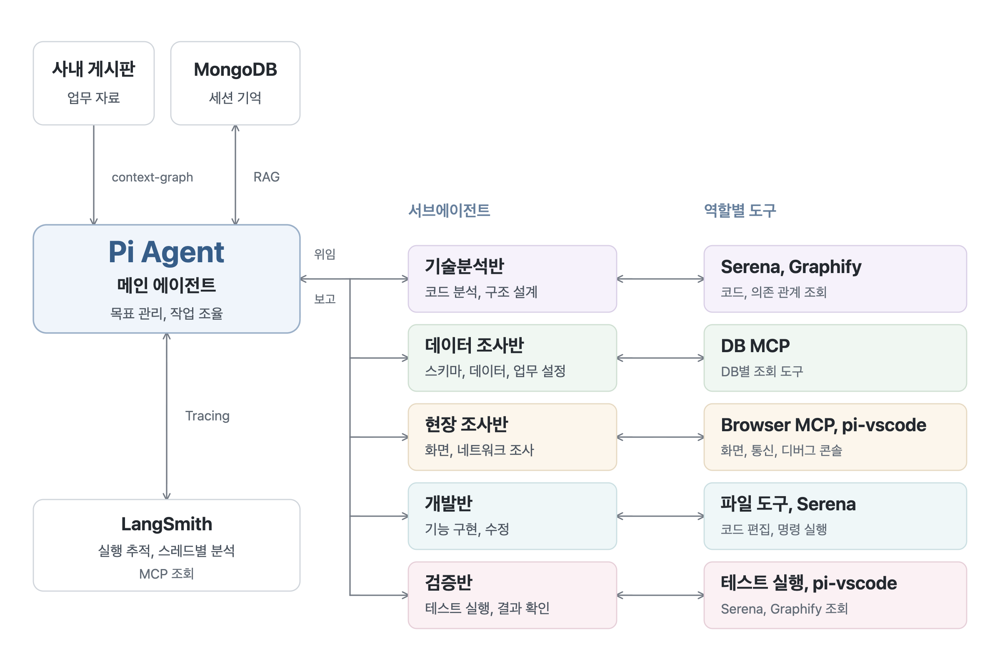
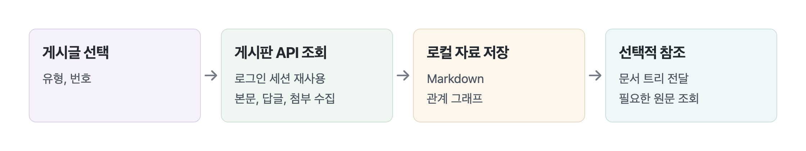
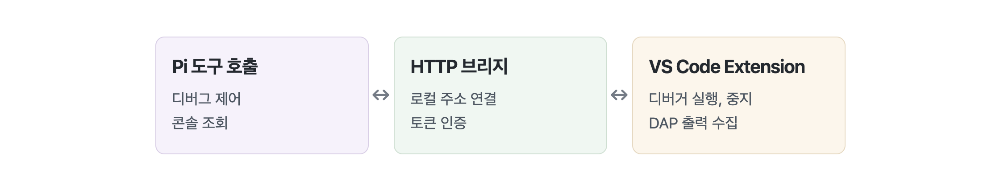
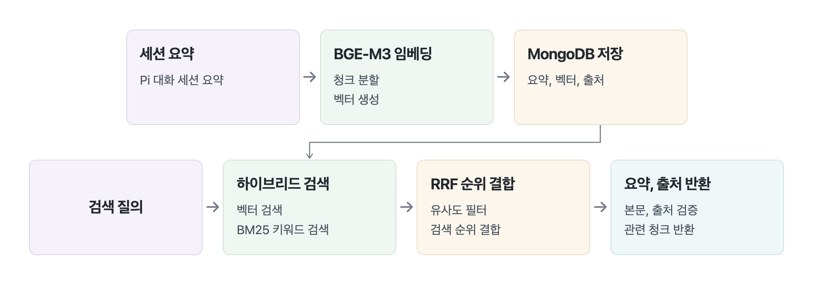
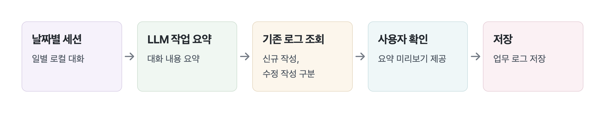

# Pi Agent Harness

**오류 접수부터 조사, 구현, 검증, 업무 기록까지 하나의 흐름으로 연결하는 에이전트 하네스**

Pi Extension API와 MCP를 기반으로 사내 게시판, 브라우저, VS Code, DB와 연동하여 필요한 컨텍스트를 주입할 수 있다.

## 목적

- **업무용 Extension 제작:** 게시글 수집, 테스트 환경 연결, 디버그 콘솔 조회, 시간 로그 작성의 통합
- **하네스 동작 이해:** 도구 등록, 세션 이벤트, 프롬프트 주입, 서브에이전트 위임, 실행 추적의 직접 구성

## 시스템 아키텍처



| 연결              | 역할                                           | 연결 방식                                    |
| ----------------- | ---------------------------------------------- | -------------------------------------------- |
| Pi ↔ VS Code      | 디버그 실행, 중지, 서버 콘솔 조회              | `pi-vscode`, 로컬 HTTP 브리지                |
| Pi ↔ Browser      | 게시글 수집, 테스트 환경 접속, 개발자도구 접근 | `context-graph`, Chrome DevTools MCP         |
| Pi ↔ DB           | 스키마, 데이터, 업무 설정 조사                 | DB별 MCP 서버                                |
| Pi ↔ MongoDB      | 과거 세션 요약 저장, 검색                      | `pi-session-rag`, 벡터, 키워드 검색          |
| Pi ↔ 서브에이전트 | 조사, 구현, 검증 위임                          | `pi-subagents`, 다섯 역할 정의               |
| Pi → LangSmith    | 실행 이력 수집, 스레드별 분석                  | 실행 환경의 tracing 연동, LangSmith MCP 조회 |

## 사용 사례

| 단계             | 기존 작업                                         | 개선 후                                                                                   |
| ---------------- | ------------------------------------------------- | ----------------------------------------------------------------------------------------- |
| 접수 내용 파악   | 본문, 답글, 연결 게시글, 첨부파일을 수동으로 복사 | `/load-context` 로 본문과 답글 및 첨부파일을 한 번에 저장하고 프롬프트에 주입             |
| 테스트 환경 준비 | 계정 확인, 서버 URL 수정, 수동 로그인             | `/test-server`로 선택 게시글의 연결 정보로 테스트 사이트 접근 및 로그인                   |
| 네트워크 조사    | 대상 탭 지정, URL, payload, response 복사         | `Chrome Devtools MCP`로 세션에 연결된 테스트 브라우저에 접근하여 네트워크 요청, 응답 조회 |
| 서버 로그 확인   | IDE 디버그 콘솔 복사, 전달                        | `vscode_debug_console`로 대상 세션의 출력 조회                                            |
| 실행 과정 점검   | 최종 답변과 터미널 기록 재확인                    | LangSmith로 스레드별 실행, 도구 호출 흐름 분석하여 개선방향 도출                          |
| 업무 기록        | 하루 작업의 수동 정리, 시간 로그 작성             | 작업 세션을 기반으로 업무 내용 요약                                                       |

## 컨텍스트 관리 전략

LangSmith 실행 이력을 통한 호출 흐름, 반복 탐색 점검과 세 가지 관리 전략 적용.
거대한 코드베이스 탐색 과정에서 나오는 ToolCall 결과가 누적되어 컨텍스트의 대부분을 차지

1. **업무 자료의 참조 전달:** 문서 트리 우선 제공, 필요 시에만 내용을 읽도록 프롬프트 구성
2. **역할별 조사 위임:** 파일 탐색, DB 및 브라우저 접근 등 컨텍스트를 많이 차지하는 작업을 서브 에이전트에게 위임
3. **과거 작업의 검색:** 전체 이력 상시 주입 대신 관련 세션 요약 조회

### 서브에이전트 역할 분리

다섯 역할별 `tools`, `extensions`, `skills` 분리.

| 역할                                          | 담당                                | 주요 도구, 구성                                       |
| --------------------------------------------- | ----------------------------------- | ----------------------------------------------------- |
| [기술분석반](agents/technical-analysis.md)    | 기존 코드, 제약 분석, 구조 설계     | Serena, Graphify 조회                                 |
| [데이터 조사반](agents/data-investigation.md) | 스키마, 데이터, 업무 설정 조회      | `pg_zeus`, 업무 설정 조회 스킬                        |
| [현장 조사반](agents/field-investigation.md)  | 화면, 재현 단계, 브라우저 통신 조사 | 브라우저 MCP, ContextGraph 브라우저 도구, `pi-vscode` |
| [개발반](agents/development.md)               | 기능 구현, 수정, 테스트 작성        | 파일 편집, 실행 도구, `ponytail`                      |
| [검증반](agents/verification.md)              | 서버 테스트와 회귀 검증             | 테스트 실행, 디버그 콘솔 조회                         |

## Custom Extensions

### context-graph: 업무 컨텍스트 수집



로그인한 Chrome의 인증 세션을 기반으로 게시판 API를 사용하여 게시글 본문, 상위 작업, 연결 게시글, 답글, 첨부파일을 수집하고 프롬프트에 주입

```text
context/<프로젝트>/job_<번호>/
├── index.md
├── job_<번호>.md
├── 개발_스프린트/
├── 회의록/
├── 오류_수정/
└── attachments/
```

**테스트 탭 연결:**

- 참조 중인 문서의 front matter 로 저장한 정보로 테스트 서버에 접근하고 로그인.
- Pi 세션과 Chrome `targetId` 연결 후 `test_tab`에서 MCP 스키마 확인, `pageId` 자동 지정.
- 동일 URL의 다른 탭으로 자동 대체 금지.

### pi-vscode: IDE 디버깅 연동

VS Code 보조 Extension의 디버거 출력 수집과 인증된 로컬 HTTP 브리지 기반의 Pi 연동.



- **실행 제어:** `launch.json` 의 실행 정보를 읽어 디버깅 실행/중단
- **콘솔 조회:** `vscode_debug_console`의 세션, 커서별 기록 조회
- **출력 수집:** VS Code와 디버거 사이의 통신 규약인 DAP의 출력 이벤트 활용

### pi-session-rag: 세션 기억 관리



- **저장:** `/rag-summary`로 세션의 작업 내용 요약 → Cloudflare BGE-M3 임베딩 → MongoDB 업로드
- **검색:** `/rag-search`로 현재 프로젝트의 자료 검색
- **순위 결합:** 의미 유사도 기반 벡터 검색과 오류명, 식별자 중심 BM25 검색 병행. RRF로 두 검색의 순위 결합

### time-log: 일일 업무 기록

날짜별 Pi 세션의 대화 내용을 수집하고 요약하여 업무 로그를 작성




## 폴더 구조
```text
.pi/
├── agents/          # 다섯 역할의 작업 범위와 도구
├── extensions/      # 업무용 Pi 명령, 도구, 이벤트 처리
├── skills/          # 반복 작업의 조사, 실행 절차
├── docs/            # 전체 구조도와 설명 자료
├── context/         # 로컬 게시글, 첨부, 관계 정보
├── sessions/        # Pi 원본 세션
└── rag-summaries/   # 세션 요약, 임베딩 결과
```
